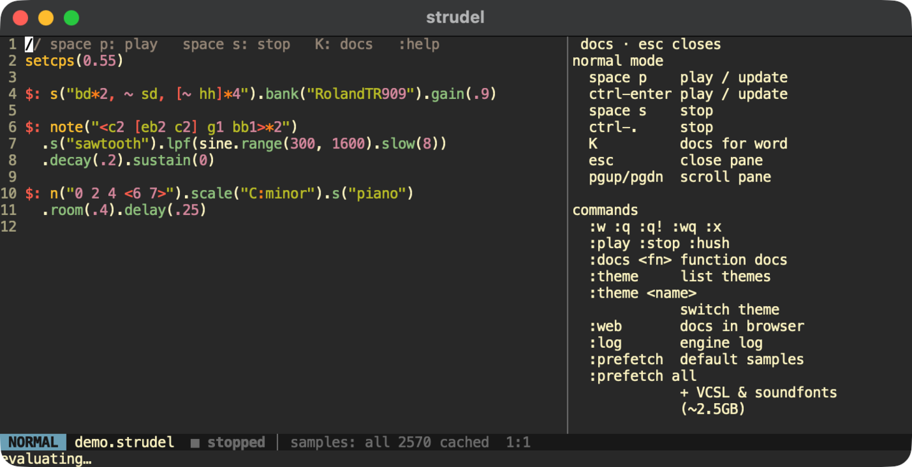

# strudel-tui

A terminal live-coding REPL for [Strudel](https://strudel.cc) — vim keys, offline samples, MIDI.



You edit `.strudel` files in a vim-style editor in your terminal. The audio comes from the real
Strudel REPL running in a hidden, bundled headless Chrome, so everything sounds exactly like
strudel.cc — synths, samples, effects, MIDI — and new Strudel features show up when upstream ships them.

- vim editing (normal / insert / visual, motions, text objects, undo, `.` repeat, `/` search)
- Strudel-aware highlighting: mini-notation, functions, `$:` labels
- notes flash as they play, like on strudel.cc
- `K` shows Strudel's docs for the function under the cursor
- works offline: every sample is cached on first play, the default packs are prefetched
- Web MIDI to your devices
- 40+ color themes, plus any `.tmTheme`
- optional auto-update from upstream Strudel every 6 hours

macOS only for now (it uses `~/Library` paths, `open` and launchd).

## How it works

```
strudel (Rust TUI) ──code──▶ chrome-headless-shell ──▶ Strudel REPL (upstream build) ──▶ audio / MIDI
        ▲                         │ fetch(samples)
        └─ errors, logs, ─────────┤
           playing ranges         ▼
                         local server: REPL files + sample cache ──▶ CDN (first time only)
```

- The Rust app is the editor, docs pane and status line ([ratatui](https://ratatui.rs) +
  [edtui](https://github.com/preiter93/edtui)), and drives Chrome over the DevTools protocol
  ([chromiumoxide](https://github.com/mattsse/chromiumoxide)).
- Strudel itself is the unmodified upstream web REPL, built from
  [codeberg.org/uzu/strudel](https://codeberg.org/uzu/strudel) and served from `127.0.0.1:4329`.
- Every remote fetch from the REPL goes through a disk cache, so anything played once works offline.
- Chrome is a private `chrome-headless-shell` (~200 MB on disk, ~300 MB RAM): no Dock icon,
  separate from any Chrome you have installed.

## Install

You need git, Rust (`cargo`), and Node 18+ (pnpm is enabled automatically via corepack).

```sh
git clone https://github.com/bewa1t/strudel-tui
cd strudel-tui
./update.sh          # clones + builds Strudel, downloads headless Chrome, installs ~/.local/bin/strudel
./install-agent.sh   # optional: auto-update every 6 hours
```

Make sure `~/.local/bin` is on your `PATH`.

## Usage

```sh
strudel song.strudel
```

A new file starts with a small beat. Press `space p` to play.

### Keys (normal mode)

| key | action |
| --- | --- |
| `space p` / `ctrl-enter` | play, or update what's playing |
| `space s` / `ctrl-.` | stop |
| `K` | docs for the function under the cursor |
| `esc` | close the side pane |
| `pgup` / `pgdn` | scroll the side pane |
| everything else | vim |

`ctrl-enter` and `ctrl-.` need a terminal with the kitty keyboard protocol
(Alacritty, kitty, WezTerm, Ghostty). `space p` / `space s` work everywhere.

### Commands

| command | action |
| --- | --- |
| `:w` | save (and update if playing) |
| `:q` `:q!` `:wq` `:x` | quit |
| `:play` `:stop` `:hush` | play / stop |
| `:help` | key and command overview |
| `:docs <fn>` | docs for a function, e.g. `:docs lpf` |
| `:web [path]` | open the offline strudel.cc docs and tutorial in your browser |
| `:log` | engine log (sample loading, errors) |
| `:theme` / `:theme <name>` | list / switch color themes (remembered) |
| `:prefetch` | download the default sample packs (also runs at startup) |
| `:prefetch all` | also VCSL (~2 GB) and all General MIDI soundfonts (~500 MB) |

### Themes

`:theme` lists the built-in themes. To add your own, drop `.tmTheme` files into
`~/Library/Application Support/strudel/themes/` and restart.

### MIDI

Use Strudel's MIDI functions as usual, e.g. `note("c e g").midi()`. Permission for Web MIDI is
granted automatically.

## Files

| path | what |
| --- | --- |
| `~/.local/bin/strudel` | the binary |
| `~/Library/Application Support/strudel/` | REPL build, docs, headless Chrome, sample cache, Chrome profile, theme |
| `~/Library/LaunchAgents/cc.strudel.tui.update.plist` | auto-update agent |
| `~/Library/Logs/strudel-update.log` | auto-update log |

Set `STRUDEL_HOME` to use a different data directory.

## Uninstall

```sh
launchctl bootout gui/$(id -u)/cc.strudel.tui.update
rm -rf ~/.local/bin/strudel ~/Library/LaunchAgents/cc.strudel.tui.update.plist \
  "$HOME/Library/Application Support/strudel" ~/Library/Logs/strudel-update.log
```

## Limitations

- vim emulation is edtui's, not real Vim: no vimrc, plugins, macros or `:s`.
- The playing-note flash pauses while the buffer differs from the last evaluated code; it resumes on
  the next play / `:w`.
- One instance at a time (the engine uses a fixed port so Strudel's settings persist).

## License

AGPL-3.0-or-later, same as Strudel. Strudel is made by its
[contributors](https://codeberg.org/uzu/strudel/activity/contributors); the default sample banks
have their own licenses, listed in the Strudel repo.
